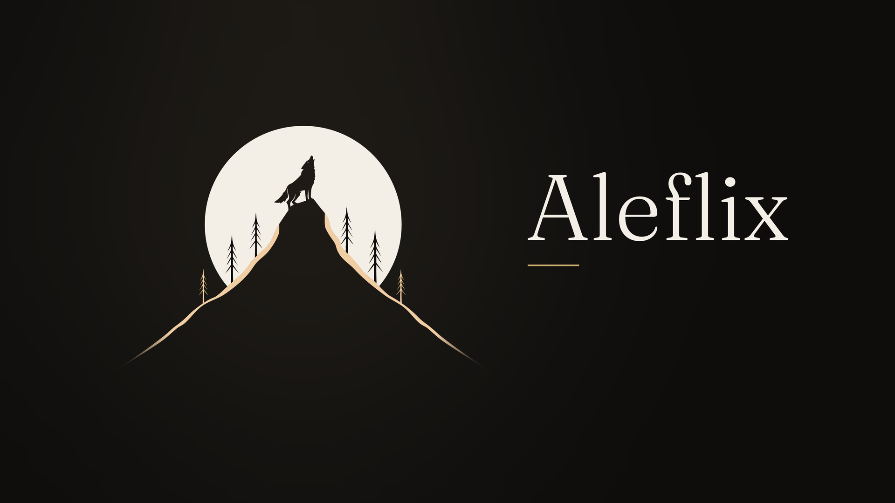

<p align="center"></p>

<h1 align="center">Aleflix</h1>
<h3 align="center">A quiet, cinematic Jellyfin client for Android phones, tablets and TVs</h3>

---

Aleflix is a media client for Jellyfin, Emby, Plex and Silo servers. It is a rebranded build of [Moonfin](https://github.com/Moonfin-Client/Moonfin-Core) with its own look: **Aleflix Noir**, a warm charcoal theme with ivory type and a single champagne-gold accent, titles set in Fraunces and the interface in Inter. The playback engine, server support and features are Moonfin's, and Aleflix keeps in step with upstream.

The focus for now is Android:

| Build | Devices | Application ID |
|-------|---------|----------------|
| `mobile` | Android phones and tablets, Android 7.0 (API 24) and up | `com.aleflix.app` |
| `androidTv` | Android TV, Google TV and Fire TV | `com.aleflix.app` |

Aleflix installs alongside Moonfin; the two don't share data.

## What's different from Moonfin

- **Aleflix Noir** is the default theme. Glass remains as an alternative; Neon Pulse and 8-bit Hero are not offered.
- A wolf-and-moon identity across the launcher icon (with an Android 13 themed icon), splash screen, Android TV banner and in-app logo.
- A soft champagne focus ring instead of cyan, and a champagne moon-phase loading animation.
- `aleflix://` deep links.
- In-app update checks read this repository's [releases](https://github.com/alejandrok5/aleflix/releases).
- Moonfin's Firebase project isn't included, so push notifications from the Moonbase plugin are off. Everything else the plugin offers (settings sync, themes, ratings, Seerr) works as in Moonfin.

## Jellyfin web theme

[**Aleflix Noir for Jellyfin web**](branding/jellyfin-web/README.md) is custom CSS for **Dashboard → Branding → Custom CSS code** that gives your server's web interface the same look as the app. The README there has the full CSS and the install steps.

The 16:9 logo for the Branding page's splash screen is in [`branding/logo/`](branding/logo): [`aleflix-logo-16x9-1080p.png`](branding/logo/aleflix-logo-16x9-1080p.png) (1920×1080) and [`aleflix-logo-16x9.png`](branding/logo/aleflix-logo-16x9.png) (3840×2160), plus a transparent version.

## Servers

Jellyfin 10.8+, Emby 4.8+, Plex Media Server 1.43+ and Silo (API v2). The optional [Moonbase server plugin](https://github.com/Moonfin-Client/Plugin) unlocks settings sync, MDBList and TMDB ratings, custom themes and more; Aleflix talks to it exactly as Moonfin does.

## Building

Requirements: Flutter 3.47+, JDK 17, Android SDK platform 36 and NDK 28.2.13676358.

```bash
flutter pub get

# Phone / tablet
flutter build apk --flavor mobile --release \
  --dart-define=DISTRIBUTION_CHANNEL=apk

# Android TV / Google TV / Fire TV
flutter build apk --flavor androidTv --release \
  --dart-define=MOONFIN_FORCE_TV=true \
  --dart-define=DISTRIBUTION_CHANNEL=android_tv_apk
```

`DISTRIBUTION_CHANNEL` turns on the in-app update check, which is only offered for sideloaded APKs.

`./build-android.sh` builds both and names the outputs `Aleflix_Android_v<version>.apk` and `Aleflix_AndroidTV_v<version>.apk`. Release signing reads `android/keystore.properties` and `android/app/release.keystore` when they exist and falls back to the debug key otherwise.

For an in-app update to find a release, attach the APKs to a GitHub release on this repository with a version tag newer than the installed build.

## Keeping up with Moonfin

See [ALEFLIX.md](ALEFLIX.md) for what this fork changes, where, and how to merge upstream releases.

## License

Aleflix is distributed under the GNU General Public License v2.0, the same license as Moonfin. See [LICENSE](LICENSE). All credit for the underlying client goes to the Moonfin developers.

Fraunces and Inter are bundled under the SIL Open Font License 1.1 (`assets/fonts/*-LICENSE.txt`).
