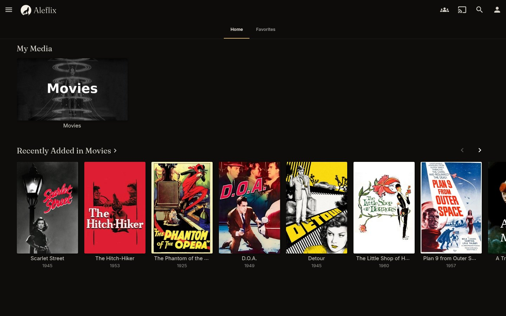
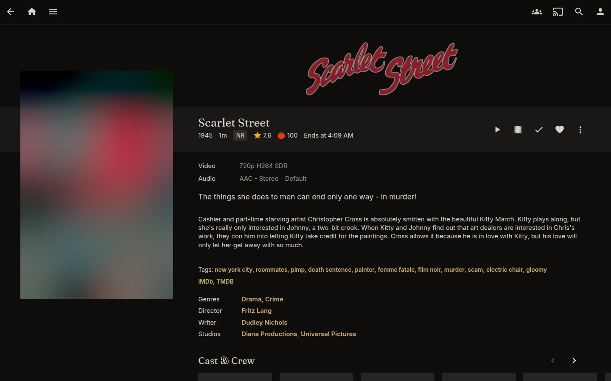
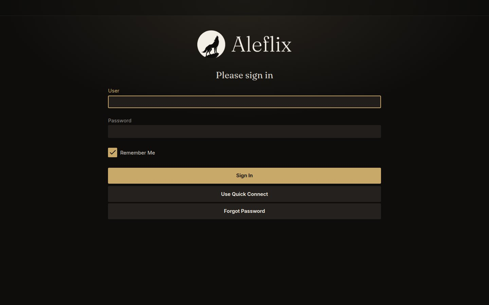
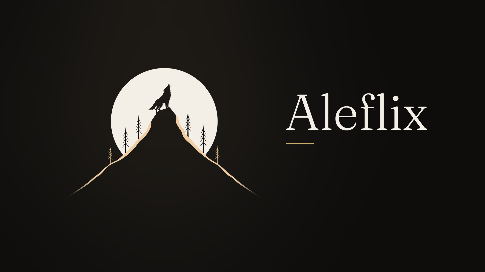

# Aleflix Noir for Jellyfin web

Custom CSS that gives the Jellyfin web interface the Aleflix look, so the server's own pages match the app: the warm charcoal background, ivory text, one champagne-gold accent in place of Jellyfin blue, Fraunces for titles and Inter for everything else, and the Aleflix logo in the header and on the sign-in page.

Made for Jellyfin 10.11 with the **Dark** display theme (the default).

| Home | Details | Sign in |
|------|---------|---------|
|  |  |  |

## Install

1. In Jellyfin, open **Dashboard → Branding**.
2. Paste the [CSS below](#the-css) into **Custom CSS code** and select **Save**.
3. Reload the web page. Jellyfin can take a reload or two to pick up new CSS.

Each user can switch the theme off for themselves under **Settings → Display → Disable server-provided custom CSS code**. If someone doesn't see it, check that box is clear and their display theme is **Dark**.

### Splash screen

The same Branding page takes a splash screen image, which Jellyfin asks to be **16:9 and at least 1920×1080**. Turn on **Enable the splash screen image**, select **Upload Custom Image**, and choose one of these:

- [`aleflix-logo-16x9-1080p.png`](../logo/aleflix-logo-16x9-1080p.png) (1920×1080)
- [`aleflix-logo-16x9.png`](../logo/aleflix-logo-16x9.png) (3840×2160)



## What it changes

- **Colours:** every Jellyfin-blue element turns champagne: buttons, links, focus rings, tabs, checkboxes, switches, sliders, progress bars, watched markers and the selected menu item. Backgrounds move to Aleflix Noir (`#0E0D0C`) and its surface tones.
- **Type:** section titles and item names use Fraunces; the rest uses Inter. Both load from Google Fonts. Chinese, Japanese and Korean text still falls back to Jellyfin's Noto fonts.
- **Logo:** the wolf-and-moon wordmark replaces the Jellyfin logo in the header, and the medallion alone appears in the TV layout. The sign-in page gets the full wordmark above the form, with a soft glow behind it.
- **The admin dashboard is unchanged.** Jellyfin doesn't apply custom CSS to the dashboard, so a broken stylesheet can't lock an admin out.

The logo images load from this repository through jsDelivr. To host them yourself, change `--aleflix-wordmark` and `--aleflix-mark` at the top of the CSS. The colours are variables in the same block.

### Following updates

To pick up changes to this theme without pasting it again, use this one line as your Custom CSS instead:

```css
@import url("https://cdn.jsdelivr.net/gh/alejandrok5/aleflix@main/branding/jellyfin-web/aleflix-noir.css");
```

jsDelivr caches files, so a change here can take a while to reach your server.

## The CSS

This is the same code as [`aleflix-noir.css`](aleflix-noir.css).

```css
/*
 * Aleflix Noir for the Jellyfin web interface
 * https://github.com/alejandrok5/aleflix/tree/main/branding/jellyfin-web
 *
 * Paste into Dashboard -> Branding -> Custom CSS code. Made for Jellyfin
 * 10.11 with the Dark display theme (the default).
 */
@import url("https://fonts.googleapis.com/css2?family=Fraunces:opsz,wght@9..144,300..600&family=Inter:wght@400;500;600&display=swap");

/* ---- Palette ----------------------------------------------------------- */
:root {
  --aleflix-noir: #0e0d0c;
  --aleflix-surface: #1a1816;
  --aleflix-raised: #24211e;
  --aleflix-input: #211e1b;
  --aleflix-line: rgba(244, 239, 230, 0.08);
  --aleflix-ivory: #f4efe6;
  --aleflix-text: rgba(244, 239, 230, 0.88);
  --aleflix-muted: #9a948a;
  --aleflix-champagne: #c8a96a;
  --aleflix-champagne-light: #e6d3a8;
  --aleflix-bronze: #8a7a5e;
  --aleflix-champagne-rgb: 200, 169, 106;
  --aleflix-font-ui: "Inter", "Noto Sans", "Noto Sans HK", "Noto Sans JP", "Noto Sans KR", "Noto Sans SC", "Noto Sans TC", sans-serif;
  --aleflix-font-title: "Fraunces", Georgia, "Noto Serif", serif;
  --aleflix-wordmark: url("https://cdn.jsdelivr.net/gh/alejandrok5/aleflix@main/branding/logo/aleflix-wordmark.png");
  --aleflix-mark: url("https://cdn.jsdelivr.net/gh/alejandrok5/aleflix@main/branding/logo/aleflix-mark.png");
}

/* Jellyfin's newer React pages draw their colours and type from these. */
html[data-theme] {
  --jf-palette-primary-main: #c8a96a;
  --jf-palette-primary-light: #e6d3a8;
  --jf-palette-primary-dark: #8a7a5e;
  --jf-palette-primary-mainChannel: 200 169 106;
  --jf-palette-primary-lightChannel: 230 211 168;
  --jf-palette-primary-darkChannel: 138 122 94;
  --jf-palette-primary-contrastText: #0e0d0c;
  --jf-palette-primary-contrastTextChannel: 14 13 12;
  --jf-palette-secondary-main: #8a7a5e;
  --jf-palette-secondary-mainChannel: 138 122 94;
  --jf-palette-background-default: #0e0d0c;
  --jf-palette-background-defaultChannel: 14 13 12;
  --jf-palette-background-paper: #1a1816;
  --jf-palette-background-paperChannel: 26 24 22;
  --jf-palette-AppBar-defaultBg: #0e0d0c;
  --jf-palette-text-primary: #f4efe6;
  --jf-palette-text-primaryChannel: 244 239 230;
  --jf-palette-text-secondary: rgba(244, 239, 230, 0.62);
  --jf-palette-text-secondaryChannel: 244 239 230;
  --jf-palette-divider: rgba(244, 239, 230, 0.1);
  --jf-palette-dividerChannel: 244 239 230;
  --jf-font-h1: 400 1.8rem/1.2 var(--aleflix-font-title);
  --jf-font-h2: 400 1.5rem/1.25 var(--aleflix-font-title);
  --jf-font-h3: 400 1.17rem/1.3 var(--aleflix-font-title);
  --jf-font-h4: 400 2.125rem/1.235 var(--aleflix-font-title);
  --jf-font-h5: 400 1.5rem/1.334 var(--aleflix-font-title);
  --jf-font-h6: 500 1.25rem/1.6 var(--aleflix-font-ui);
  --jf-font-subtitle1: 400 1rem/1.75 var(--aleflix-font-ui);
  --jf-font-subtitle2: 500 0.875rem/1.57 var(--aleflix-font-ui);
  --jf-font-body1: 400 1rem/1.5 var(--aleflix-font-ui);
  --jf-font-body2: 400 0.875rem/1.43 var(--aleflix-font-ui);
  --jf-font-button: 500 0.875rem/1.75 var(--aleflix-font-ui);
  --jf-font-caption: 400 0.75rem/1.66 var(--aleflix-font-ui);
  --jf-font-overline: 400 0.75rem/2.66 var(--aleflix-font-ui);
}

/* ---- Type -------------------------------------------------------------- */
html,
body,
button,
input,
select,
textarea,
.emby-button {
  font-family: var(--aleflix-font-ui);
}

h1,
h2,
.sectionTitle,
.pageTitle,
.itemName,
.MuiTypography-h1,
.MuiTypography-h2,
.MuiTypography-h3 {
  font-family: var(--aleflix-font-title);
  font-optical-sizing: auto;
  font-weight: 400;
  letter-spacing: 0.005em;
}

html,
.skinHeader {
  color: var(--aleflix-text);
}

.cardText-secondary,
.fieldDescription,
.guide-programNameCaret,
.listItem .secondary,
.nowPlayingBarSecondaryText,
.programSecondaryTitle,
.secondaryText,
.checkboxListLabel,
.inputLabel,
.inputLabelUnfocused,
.paperListLabel,
.textareaLabelUnfocused {
  color: rgba(244, 239, 230, 0.56);
}

::selection {
  background: rgba(var(--aleflix-champagne-rgb), 0.35);
  color: var(--aleflix-ivory);
}

/* ---- Surfaces ---------------------------------------------------------- */
/* html:root outranks the .preload rule Jellyfin keeps on <html>. */
html:root,
.backgroundContainer,
.dialog,
.drawer-open,
.mainDrawer,
.nowPlayingContextMenu,
.nowPlayingPlaylist,
.noBackdropTransparency .detailPagePrimaryContainer,
.noBackdropTransparency .detailPageSecondaryContainer {
  background-color: var(--aleflix-noir);
}

.backgroundContainer.withBackdrop {
  background-color: rgba(14, 13, 12, 0.86);
}

.skinHeader-withBackground {
  background-color: rgba(14, 13, 12, 0.94);
  border-bottom: 1px solid var(--aleflix-line);
}

.skinHeader.semiTransparent {
  background-color: rgba(14, 13, 12, 0.45);
}

.layout-tv .skinHeader.semiTransparent {
  background: none;
}

.collapseContent,
.formDialogFooter:not(.formDialogFooter-clear),
.formDialogHeader:not(.formDialogHeader-clear),
.paperList,
.visualCardBox,
.appfooter,
.playlistSectionButton,
.detailRibbon,
.infoBanner {
  background-color: var(--aleflix-surface);
}

.fab,
.raised,
.toast {
  background: var(--aleflix-raised);
  color: var(--aleflix-ivory);
}

.fab:focus,
.raised:focus {
  background: #2e2a26;
}

.listItem:hover,
.navMenuOption:hover {
  background: #1f1c19;
}

.listItem:focus {
  background: #2a2622;
}

.actionsheetDivider {
  background: var(--aleflix-line);
}

.mediaInfoText {
  background: rgba(244, 239, 230, 0.1);
  color: var(--aleflix-text);
}

/* Library tiles without artwork */
.defaultCardBackground1 { background-color: #2a241c; }
.defaultCardBackground2 { background-color: #3a3124; }
.defaultCardBackground3 { background-color: #4a3e2c; }
.defaultCardBackground4 { background-color: #231f1a; }
.defaultCardBackground5 { background-color: #5c4d36; }

* {
  scrollbar-color: #3a352f transparent;
}

::-webkit-scrollbar-track-piece {
  background-color: transparent;
}

::-webkit-scrollbar-thumb:horizontal,
::-webkit-scrollbar-thumb:vertical {
  background-color: #3a352f;
}

/* ---- Logo -------------------------------------------------------------- */
.pageTitleWithDefaultLogo {
  background-image: var(--aleflix-wordmark);
}

.layout-tv .pageTitleWithDefaultLogo {
  background-image: var(--aleflix-mark);
}

/* ---- Accent: champagne in place of Jellyfin blue ----------------------- */
.button-submit,
.emby-button.detailFloatingButton,
.selectionCommandsPanel,
.listItemIcon:not(.listItemIcon-transparent),
.subtitleFeaturePillow,
.lyricsFeaturePillow {
  background: var(--aleflix-champagne);
  color: var(--aleflix-noir);
}

.button-submit:focus,
.button-submit:hover {
  background: var(--aleflix-champagne-light);
  color: var(--aleflix-noir);
}

.layout-tv .emby-button.detailFloatingButton:focus {
  background-color: var(--aleflix-ivory);
  color: var(--aleflix-noir);
}

.emby-button.show-focus:focus,
.alphaPickerButton-tv:focus,
.emby-select-tv-withcolor:focus,
.guide-channelHeaderCell:focus,
.programCell:focus,
.guide-date-tab-button.show-focus:focus {
  background-color: var(--aleflix-champagne) !important;
  color: var(--aleflix-noir) !important;
}

.button-flat:hover,
.button-link,
.button-accent-flat,
.buttonActive,
.inputLabelFocused,
.selectLabelFocused,
.textareaLabelFocused,
.emby-tab-button.show-focus:focus,
.emby-tab-button:hover,
.guide-date-tab-button.emby-tab-button-active,
.guide-date-tab-button:focus,
.upNextDialog-countdownText,
.metadataSidebarIcon,
.playstatebutton-icon-played,
.paper-icon-button-light.show-focus:focus,
#dialogToc .bookplayerButtonIcon:hover,
#dialogToc .toc li a:active,
#dialogToc .toc li a:hover {
  color: var(--aleflix-champagne) !important;
}

.emby-tab-button-active {
  color: var(--aleflix-ivory);
  box-shadow: inset 0 -2px 0 var(--aleflix-champagne);
}

@media (hover: hover) and (pointer: fine) {
  .paper-icon-button-light:hover:not(:disabled) {
    background-color: rgba(var(--aleflix-champagne-rgb), 0.16);
    color: var(--aleflix-champagne-light);
  }
}

.paper-icon-button-light:active:not(:disabled),
.listItemImageButton:hover {
  background-color: rgba(var(--aleflix-champagne-rgb), 0.16);
  color: var(--aleflix-champagne-light);
}

.navMenuOption-selected {
  background: rgba(var(--aleflix-champagne-rgb), 0.14) !important;
  color: var(--aleflix-champagne-light);
  box-shadow: inset 3px 0 0 var(--aleflix-champagne);
}

.card:focus .cardBox.visualCardBox,
.card:focus .cardBox:not(.visualCardBox) .cardScalable {
  border-color: var(--aleflix-champagne) !important;
}

.itemSelectionPanel {
  border-color: var(--aleflix-champagne);
}

/* Progress, sliders, spinners */
.itemProgressBarForeground,
.mdl-slider-background-lower,
.sliderMarker.watched,
.iconOsdProgressInner,
.playbackProgress > div {
  background-color: var(--aleflix-champagne);
}

.mdl-slider {
  color: var(--aleflix-champagne);
}

.mdl-slider::-webkit-slider-thumb {
  background: var(--aleflix-champagne-light);
}

.mdl-slider::-moz-range-thumb {
  background: var(--aleflix-champagne-light);
}

progress::-webkit-progress-value {
  background-color: var(--aleflix-champagne);
}

progress::-moz-progress-bar {
  background-color: var(--aleflix-champagne);
}

progress[aria-valuenow]::before {
  background-color: var(--aleflix-champagne);
}

.progressring-spiner,
.mdl-spinner__layer-1,
.mdl-spinner__layer-2,
.mdl-spinner__layer-3,
.mdl-spinner__layer-4 {
  border-color: var(--aleflix-champagne);
}

/* Indicators on posters */
.countIndicator,
.fullSyncIndicator,
.mediaSourceIndicator,
.playedIndicator {
  background: var(--aleflix-champagne);
  color: var(--aleflix-noir);
}

/* Form controls */
.emby-input,
.emby-textarea,
.emby-select-withcolor {
  background: var(--aleflix-input);
  border-color: var(--aleflix-input);
}

.emby-select-withcolor > option {
  background: var(--aleflix-surface);
}

.emby-input:focus,
.emby-textarea:focus,
.emby-select-withcolor:focus {
  border-color: var(--aleflix-champagne) !important;
}

.emby-checkbox:checked + span + .checkboxOutline {
  background-color: var(--aleflix-champagne);
  border-color: var(--aleflix-champagne);
}

.emby-checkbox:checked + span + .checkboxOutline > .checkboxIcon-checked {
  color: var(--aleflix-noir);
}

.emby-checkbox:focus:not(:checked) + span + .checkboxOutline {
  border-color: var(--aleflix-champagne);
}

.mdl-switch__input:checked + .mdl-switch__label + .mdl-switch__trackContainer > .mdl-switch__track {
  background: rgba(var(--aleflix-champagne-rgb), 0.5);
}

.mdl-switch__input:checked + .mdl-switch__label + .mdl-switch__trackContainer > .mdl-switch__thumb {
  background: var(--aleflix-champagne);
}

.mdl-switch__input:checked:focus + .mdl-switch__label + .mdl-switch__trackContainer .mdl-switch__focus-helper {
  background-color: rgba(var(--aleflix-champagne-rgb), 0.26);
  box-shadow: 0 0 0 1.39em rgba(var(--aleflix-champagne-rgb), 0.26);
}

.mdl-radio.show-focus .mdl-radio__button:focus + .mdl-radio__circles .mdl-radio__outer-circle,
.mdl-radio.show-focus .mdl-radio__button:focus + .mdl-radio__circles .mdl-radio__inner-circle {
  color: var(--aleflix-champagne);
}

.mdl-radio__focus-circle {
  background: var(--aleflix-champagne);
}

/* ---- Sign-in page ------------------------------------------------------ */
#loginPage {
  background:
    radial-gradient(ellipse 70% 55% at 50% 0%, rgba(138, 122, 94, 0.2), transparent 70%),
    var(--aleflix-noir);
}

#loginPage .manualLoginForm::before,
#loginPage .visualLoginForm::before {
  content: "";
  display: block;
  height: 5.5em;
  margin: 1.5em auto 1em;
  max-width: 80%;
  background: var(--aleflix-wordmark) center / contain no-repeat;
}

/* The page carries the logo, so the header doesn't repeat it. */
body:has(#loginPage:not(.hide)) .pageTitleWithDefaultLogo {
  visibility: hidden;
}

#loginPage .cardBox {
  border-radius: 0.5em;
}
```
